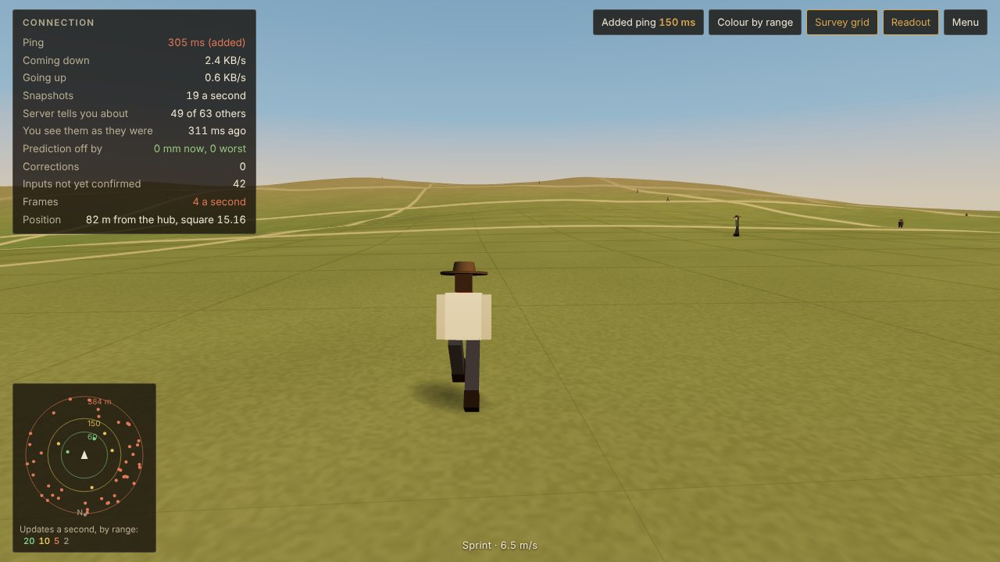

# Calder Territory (working title)

A Wild West open world for the browser, built on the bones of [HoodWar](https://github.com/Malachi-Nelson/HoodWar):
frontier, 1899, up to 64 players in one world on an authoritative server. This repository is at **Phase 2 of 11**:
the networking foundation and a test range to try it on. There is no map, horse or gun yet.



The pictures in `docs/screenshots/` come from a headless browser that draws in software, which is why the readout
in them shows a few frames a second.

## What works today

- An authoritative world server: 20 ticks a second, movement stepped at 60 Hz, one process per 64-player world.
- A binary protocol over WebSockets, with interest management (you are only told about what is within 384 m),
  priority-ordered snapshots under a fixed byte budget, and delta-encoded positions.
- Client prediction that agrees with the server to the last bit, reconciliation when it does not, and smooth
  drawing of everyone else a tenth of a second in the past.
- The same server code running inside a browser tab, with bots, so playing alone needs no hosting at all.
- On-foot movement tuned for weight: about 0.9 s to reach a sprint, 0.4 s and 1.3 m to stop, a 2 m turning arc.
- A load test with 64 real clients at 150 ms ping. It passes every gate (numbers in `docs/ARCHITECTURE.md`).

## Run it

Needs Node 22 or newer.

```sh
npm install
npm test                 # unit and end-to-end tests
npm run build            # writes client/dist/index.html, one self-contained page
npm start                # the world server on :8080 (PORT, BOTS, SPAWN, ORIGINS in the environment)
npm run loadtest         # 64 simulated players against a fresh server; add -- --quick for the 1-minute version
```

Open `client/dist/index.html` in a browser to play in the tab's own world. To join a server instead, add
`?server=ws://localhost:8080` to the address, or type the address into the title card.

`node tools/check-client.mjs` drives the built page in a headless browser and saves screenshots to `tools/out/`.
It needs Playwright, which is not in `package.json` (`npm i -D playwright && npx playwright install chromium`).

## Layout

```
shared/            code both sides run: wire format, constants, terrain, collision, movement
  net/             codec.js (bytes), messages.js (every message)
  sim/             moveFoot.js (the movement step), trig.js (exact sine and cosine)
  world/           terrain.js, collide.js, field.js (the Phase 2 test field)
server/src/core/   the authoritative world; no Node in it, so it also runs in a browser tab
server/src/node/   the WebSocket gateway and the /health and /status pages
client/src/        the game page: net/ input/ player/ render/ ui/ state/
tools/             build-client.mjs, check-client.mjs, loadtest/run.mjs
test/              node:test suites
docs/              ARCHITECTURE.md, PROTOCOL.md, HOSTING.md
```

The rule that keeps the two sides honest: `client/` never imports from `server/`, except `client/src/net/local.js`
and `world-worker.js`, which exist to run a whole server in the tab. `shared/` imports from neither.

## Hosting, for free

Four ways to run a world without paying, from least to most effort. Details and limits are in `docs/HOSTING.md`.

1. In the browser tab. Nothing to set up. One player and bots.
2. On your own PC, behind a Cloudflare quick tunnel. Friends join with a link. Lasts as long as your PC is on.
3. On Render's free instance. Always reachable, but small: good for a handful of players, not a full world.
4. On an Oracle Cloud Always Free machine. Enough for a full world; the most setup.

## Phases

1. Audit of HoodWar and the architecture plan. Done.
2. Server and networking foundation, load-tested with 64 clients. **This commit.**
3. World foundation: the map, streamed terrain, towns, day and night, weather.
4. Combat, the focus meter, law and wanted levels.
5. Accounts, saving, economy.
6. Bounty hunting. 7. Hunting, fishing, camp. 8. Trains and robberies. 9. The living-world pass.
10. Roles, events, posses, PvP. 11. Polish.
