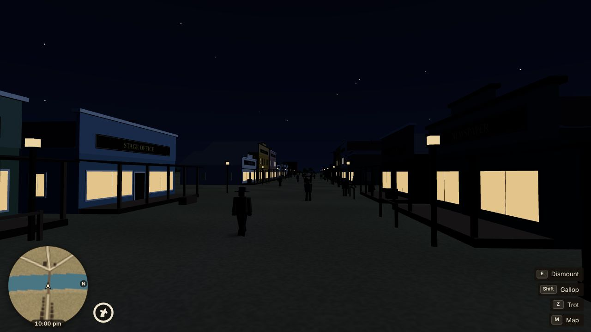
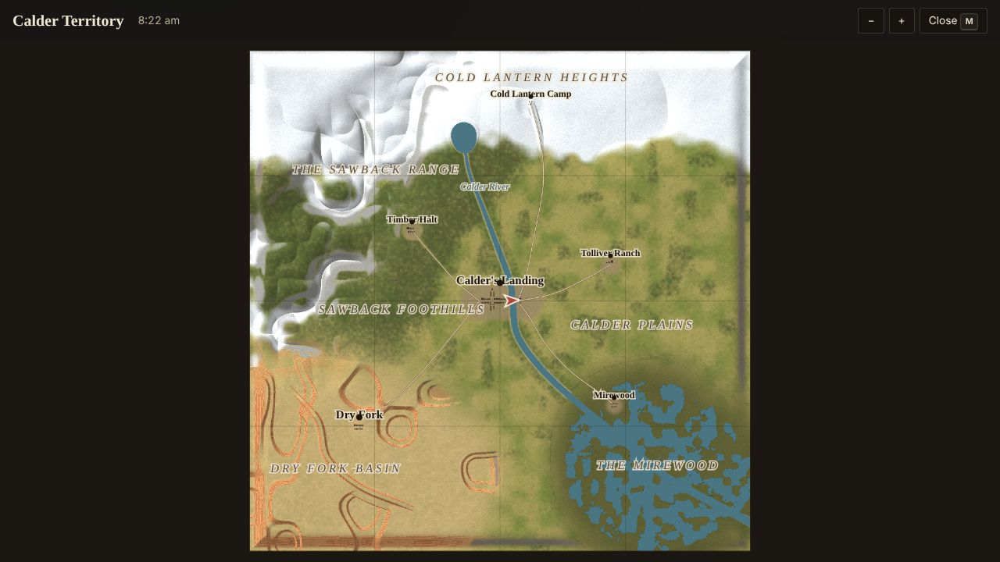

# CowboyOnline — Calder Territory

**Play it: <https://malachi-nelson.github.io/CowboyOnline/>**

Cowboy Online is a Wild West open world for the browser, built on the bones of
[HoodWar](https://github.com/Malachi-Nelson/HoodWar): the frontier in 1899, up to 64 players in one world on an
authoritative server. Calder Territory is the world it is set in. This repository is at **Phase 3 of 11**: the
territory and your horse. There are no guns yet.


| | |
|---|---|
|  |  |
|  |  |

The pictures in `docs/screenshots/` come from a headless browser that draws in software.

## What works today

- **A territory to ride across.** Four kilometres square: Calder's Landing on the Calder river with a bridge, the
  Sawback Range and its pine forest to the north-west, the snowy high country and Cold Lantern Camp in the far
  north, the plains and Tolliver Ranch to the east, the Mirewood swamp to the south-east, and the Dry Fork desert,
  its buttes and its canyon to the south-west. Roads join the five settlements, with telegraph poles along them.
  Everything is made from one seed by plain arithmetic, so the browser and the server build the same world.
- **Your horse.** It stands beside you when you arrive. **H** whistles: it comes at a run, and if it is too far off
  to run all the way it is brought in behind you, out of sight, and runs the rest. **E** mounts and dismounts.
  It walks, trots, canters and gallops (17 m/s flat out, about 60 km/h), takes about four seconds to reach a
  gallop and two and a half to pull up, turns wider the faster it goes, will not climb a cliff, swims rivers, and
  is winded after half a minute of galloping. **Space** jumps: from a canter or a gallop it clears a fence, a
  hitching rail or a trough if you take off in the right place.
- **A lived-in world.** Townsfolk walk the streets; riders travel the roads, stop at the end of them, stretch their
  legs, whistle their horses back and ride on. A day lasts 48 minutes, windows light up after dark, and the weather
  comes and goes: rain on the plains, snow in the high country, mist in the Mirewood.
- **The netcode from Phase 2, now carrying horses.** An authoritative server at 20 ticks a second, prediction that
  agrees with the server to the last bit (your horse included), interest management and a fixed bandwidth budget.
- **A small screen.** A round map that turns with you, the time, your horse's wind, what the keys do right now, the
  name of a place as you ride into it, and a full map on **M**. The Phase 2 instruments are behind **F3**.

## Run it

Needs Node 22 or newer.

```sh
npm install
npm test                 # unit and end-to-end tests
npm run build            # writes client/dist/index.html, one self-contained page
npm start                # the world server on :8080 (PORT, BOTS, SPAWN, ORIGINS, HOUR in the environment)
npm run loadtest         # 64 simulated players against a fresh server; add -- --quick for the 1-minute version
```

Open `client/dist/index.html` in a browser to play in the tab's own world. To join a server instead, add
`?server=ws://localhost:8080` to the address, or type the address into the title card. `?hour=21` starts the
tab's world at nine in the evening.

## How the page gets published

Every push to `main` runs the tests, builds the page and puts `client/dist/index.html` on the `gh-pages` branch
(`.github/workflows/ci.yml`). GitHub Pages serves that branch at the address above. Nothing built is kept on `main`.

`node tools/check-client.mjs` drives the built page in a headless browser: it walks away from the horse, whistles,
mounts, gallops with 150 ms of added ping, dismounts, and fails on any page error or prediction error. `--tour`
also takes pictures around the territory, at dusk, at night and in the rain. It needs Playwright, which is not in
`package.json` (`npm i -D playwright && npx playwright install chromium`).

## Layout

```
shared/            code both sides run
  net/             codec.js (bytes), messages.js (every message)
  sim/             moveFoot.js, moveHorse.js, actor.js (a player, their horse, the whistle), trig.js
  world/           terrain.js (ground, water, regions, roads), trees.js, towns.js, field.js, weather.js, collide.js
server/src/core/   the authoritative world and the bots; no Node in it, so it also runs in a browser tab
server/src/node/   the WebSocket gateway and the /health and /status pages
client/src/        the game page
  net/             session (prediction, reconciliation, interpolation), transports, the in-tab world
  render/          scene (sky, sun, day and night), terrain and water, trees, towns, weather, figures, build.js
  input/ player/   controls, camera
  ui/              hud.js (the corners), map.js, page.html, style.css
  audio/           sound.js (footfalls, hoofbeats, the whistle, wind, water, rain, birds, crickets)
tools/             build-client.mjs, check-client.mjs, check-two-players.mjs, loadtest/run.mjs
test/              node:test suites
docs/              ARCHITECTURE.md, PROTOCOL.md, HOSTING.md
```

The rule that keeps the two sides honest: `client/` never imports from `server/`, except `client/src/net/local.js`
and `world-worker.js`, which exist to run a whole server in the tab. `shared/` imports from neither.

## Hosting, for free

Four ways to run a world without paying, from least to most effort. Details and limits are in `docs/HOSTING.md`.

1. In the browser tab. Nothing to set up. One player and bots.
2. On your own PC, behind a Cloudflare quick tunnel. Friends join with a link. Lasts as long as your PC is on.
3. On Render's free instance. Always reachable, but small: good for a handful of players, not a full world.
4. On an Oracle Cloud Always Free machine. Enough for a full world; the most setup.

## Phases

1. Audit of HoodWar and the architecture plan. Done.
2. Server and networking foundation, load-tested with 64 clients. Done.
3. World foundation: the territory, towns, horses, day and night, weather. Done.
4. Combat, the focus meter, law and wanted levels.
5. Accounts, saving, economy.
6. Bounty hunting. 7. Hunting, fishing, camp. 8. Trains and robberies. 9. The living-world pass.
10. Roles, events, posses, PvP. 11. Polish.
